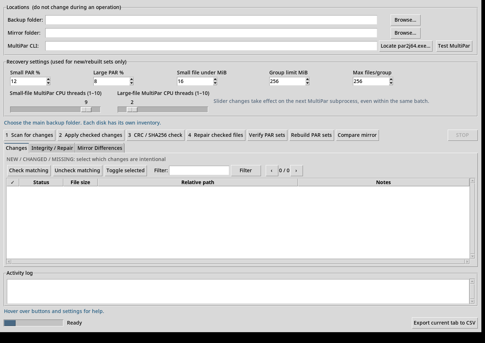

# ParityKeeper v1.2 — Updated Complete Technical Specification

**Normative precedence:** The v1.2 verified audit and fixes below supersede contradictory material in the historical v1.1 reconstruction specification appended afterward. It is supplied for complete GUI, database, API, and workflow context.

# ParityKeeper v1.2 — Verified Code Audit, Fixes and Developer Notes

**Release:** 1.2.0, 19 October 2026  
**Applies to:** Windows (MultiPar `par2j64.exe`) and Debian Linux (`par2cmdline`, `par2`)  
**Primary inputs:** the user-supplied *ParityKeeper v1.1 — Code Analysis Report*, actual v1.1 Windows and Debian source ZIPs, the previous 45-page v1.1 technical specification, and the newly revised v1.2 source.  
**Read before production use:** v1.2 was tested with *simulated* PAR2 engines; real MultiPar / `par2` must still pass the application's disposable self-test on the intended computer. Keep both physical HDD copies. Do not test destructive recovery on your only surviving copy.

## 1. Scope, methodology, evidence

This review compared findings to *both* v1.1 branches, rather than assuming identical source files. This matters: the report calls out some real vulnerabilities, but also includes inaccurate claims. We also checked the official engine manuals for PAR2 exit statuses and command-line CPU options. Fixes were introduced conservatively, with failure modes that preserve the source files and committed recovery data. A new regression suite exercises filenames differing only by case, migration, content races, missing mirrors, path traversal, backup quarantine collisions and platform-specific exit handling.

**Important conclusion:** the report's statement that the application was safe for production is **not an independent certification**. v1.1 included material edge cases. v1.2 improves them, but is not yet field-validated with the real Windows and Debian PAR2 binaries, 7 TB-scale data sets, or actual hard-drive failure scenarios.

## 2. Issue-by-issue disposition

| Report finding | Verification against v1.1 | v1.2 corrective action / status |
|---|---|---|
| **Linux filenames collide under `NOCASE`** | **Confirmed.** `files` and temporary `seen` used `COLLATE NOCASE`. SQLite usually raises a uniqueness error rather than silently overwriting a duplicate; either behavior prevents tracking both. | **Fixed.** Both tables use `BINARY`. Existing databases migrate transactionally on normal opening, with a full SQLite copy kept under snapshots before conversion. All group-matching logic now uses exact path strings, not `.casefold()`. |
| Missing-file deletion dialog unclear | **Confirmed usability issue.** `apply_changes()` already refused reappeared files and did not delete filesystem sources. | **Fixed.** Approval prompt expressly says **inventory entry only**; source files are already missing and are not deleted by the program. |
| Quarantine destination collision and ignored failures | **Confirmed.** Quarantine name was based on second-level timestamp; `shutil.move()` failure was logged and swallowed. | **Fixed.** Unique timestamp+UUID directory, no overwrite on collision, explicit returned errors. On incomplete quarantine, the UI retains the repair issue for manual inspection even when restored hashes are good. |
| Mirror missing-inventory validation | **Confirmed.** A missing folder inventory produced a less useful exception. | **Fixed.** Both inventories are checked in the engine and GUI; comparing does not create a missing database. |
| File changes during PAR creation despite stable size/mtime | **Confirmed limited race.** Code hashed before PAR generation but checked only size/mtime afterward. | **Fixed.** A second streaming SHA256+CRC32 comparison for **every** member is required after PAR creation and external verification, before the SQLite commit. Costs an additional complete source read; progress estimate updated. |
| Same PAR2 exit-code masks used on Linux and Windows | **Partly incorrect report.** Debian v1.1 already handled numeric 0/1 verify and 0 repair separately. Windows used bit flags. | **Clarified and hardened.** Added named per-platform success/repairability helpers and regression tests. Never evaluate Linux numeric codes using Windows bitmasks. See section 5. |
| `live_threads` GUI/worker synchronization | **Confirmed implementation gap**, though individual Python dict reads are usually atomic under CPython. | **Fixed.** `threading.Lock` guards both slider writes and worker reads. Critically, the lock is acquired **inside** the worker's provider callback—not only while the callback is created. |
| No persistent activity log | **Confirmed.** Only the Tk text widget retained messages. | **Fixed.** `activity.log` with 5 MB rotating files and 3 backups is kept in the user's ParityKeeper configuration directory. It captures GUI logs and PAR2 messages delivered through the GUI. |
| Orphan PAR directories accumulate after interruption | **Confirmed.** Uncommitted recovery folders can remain if the process crashes. | **Safely addressed.** Added **Review leftover PAR2** button and `list_orphan_par_dirs`. **No automatic deletion**, because unfinished PAR files may still aid recovery. |
| No persistent resume state | **Partly valid.** v1.1 already commits per successful group and resumes by rescanning, but did not record interruption state. | **Partially addressed.** `last_apply_state.json` records state and committed group count. It is *diagnostic only*: re-scan and re-approve outstanding changes. Never replay old approvals automatically. |
| Path traversal handling too basic | **Partial concern.** `../` and absolute paths were already rejected; URL percent encodings are not decoded into filesystem traversal. The report's `str(p).startswith(str(root))` replacement is itself unsafe (`/data/a` vs `/data/another`). | **Hardened.** Reject non-canonical/absolute/parent paths, NULs, symlink/junction traversal and paths escaping the canonical root. Internal PAR index references have separate allowlisting and UUID validation. |
| Memory grows with very large result lists | **Confirmed architectural limitation.** GUI pages the view, but retains all results in Python lists. | **Not fully fixed.** SQLite-backed lazy result pagination remains future work. Affected mostly by **file count**, not total terabytes. |
| Report: “comparison has `@exclusive_archive`” | **Incorrect** for supplied Windows and Debian v1.1 source: the function has no decorator. The original v1.1 specification saying it lacks an archive lock was accurate. | **No behavioral change.** Comparison remains baseline-only and read-oriented; simultaneous inventory writers are not excluded across both roots. Use comparison with no other ParityKeeper job running on either drive. |
| Report's overall count of 19 issues | **Not itemized in full.** The text lists multiple substantive findings but not individually demonstrable evidence for every count. | We address listed verifiable findings above; we do not claim 19 uniquely fixed bugs. |

## 3. File layout, inventory, and migration

An archive stores its own `.paritykeeper/` directory:

```text
<backup-root>/
  <user photos, text, videos, folders ...>
  .paritykeeper/
    inventory.sqlite3
    operation.lock
    last_apply_state.json               # NEW: diagnostic checkpoint
    par2/<UUID>/data.par2
    par2/<UUID>/*.vol*.par2
    snapshots/inventory_*.sqlite3
    snapshots/inventory_before_case_migration_<UUID>.sqlite3  # NEW: retained
    quarantine/<timestamp>_<UUID>/...    # NEW: collision-resistant path
```

The SQLite `sets` and `events` tables are unchanged. `files` retains the same columns and values, but the primary key is now `path TEXT PRIMARY KEY COLLATE BINARY`. The temporary scan table `seen` uses `BINARY`, and SQL joins use exact case-sensitive path values. Cross-platform parity member updates, deletions and grouping must not use `.casefold()` to select inventory rows.

**Migration algorithm:** with the archive lock held by Scan/Apply, open a legacy `NOCASE` inventory; create a separate complete SQLite backup with SQLite's `backup()` API; start a transaction; copy rows into a newly created `files_case_sensitive` table with the identical columns but BINARY PK; drop the old table; rename the new table; rebuild `files_by_set`; commit. An error rolls back the transaction and reports the backup path. The snapshot copy is intentionally **not** managed by the normal three-snapshot rotation. Scanning with v1.2 detects missing case variants as NEW and they can be approved/protected normally.

**Safety caveat:** If an earlier program somehow lost an inventory entry, migration cannot reconstruct its old checksum; scan will discover the file as NEW. Existing PAR sets on disk remain intact. Always retain a physically separate mirror before upgrading.

## 4. Exact PAR-set update transaction and TOCTOU mitigation

For each small group or single large file:

1. Validate selected operations. `NEW` is selected by default; `CHANGED` and `MISSING` are initially unchecked. A missing file must still be absent when Apply starts.
2. Hash incoming files using 8 MiB chunks, producing `(size, mtime_ns, SHA256, CRC32)`.
3. For retained members in an old set, hash and verify content against the current approved baseline before including those members in a new PAR set.
4. Build recovery files in a fresh UUID directory. Engines are invoked directly with a **list of arguments**, not via shell command interpolation.
5. Require successful PAR2 creation and at least one recovery volume for nonempty source data.
6. Check each member's size/mtime for ordinary writes detected while creating the parity files.
7. Run the native PAR2 **verify** command. Only a success result is allowed for the newly created set.
8. **NEW IN 1.2:** read and hash **every member again**. Fail if size, SHA256 or CRC32 differs from the hash captured before creation, even if mtime and size were deliberately restored.
9. In a single SQLite transaction, add the new verified set, redirect the file records, retire the old set, and log the event. Commit.
10. Only **after commit** may the implementation retire/clean the superseded PAR2 directory. A failed pre-commit operation leaves the old approved baseline intact.
11. Persist progress (`groups_committed`, `updated_utc`, `requires_new_scan`) to `last_apply_state.json`. This is not an authorization to resume without rechecking content.

This defense materially reduces a time-of-check/time-of-use race, but no application-level hashing can provide atomic filesystem snapshots while other software concurrently writes the same files. **Do not modify source files during PAR creation, validation or repair.** Keep your second physical copy.

## 5. Platform-specific PAR2 command semantics

### Windows MultiPar (`par2j64.exe`)

Creation uses `c`, `/fu` UTF-8 file list, `/d<root>`, `/uo`, `/lcN`, and `/rrP` (large) or `/ssSIZE` plus `/rnBLOCKS` (small). Verification uses `v /lcN /d<root> /uo <index>`. Repair uses `r /b /lcN /d<root> /uo <index>`; `/b` preserves damaged originals as numbered siblings when generated. `/lc1` through `/lc10` really does limit the number of processing threads, per MultiPar's detailed documentation.

**Windows MultiPar return status is bitwise:** 0 normal, bit 1 fatal, 2 canceled, 4 incomplete sources, 8 insufficient repair blocks, 16 repair succeeded, 256 incomplete parity; 32/64/128 indicate candidate recovery strategies when coupled with incomplete-source flags. Verification may return 132 (=128+4) when repair is possible; do **not** treat all nonzero verify codes as fatal. Repair command results `0` and `16` are treated as acceptable for proceeding to post-repair SHA256/CRC32, but failure flags (1/2/4/8/256) are rejected. **A nominally successful engine return is not proof of restored content**: hashes of all set members must match.

### Debian (`par2` / par2cmdline)

Creation uses `c -tN -Tmin(N,2) -B<root> <index> -- <relative filenames>`. Verification uses `v -tN -Tmin(N,2) -B<root> <index>`; repair `r` with the same options. A single subprocess handles each set. Existing v1.1 Debian code already used the numeric return classes correctly.

**Debian exit statuses are enumerated, not bitwise:** `0` complete, `1` repair possible (verify), `2` not repairable, `3` invalid flags, `4` missing critical data, `5` failed repair, `6` IO error, `7` internal error, `8` memory error. Run repair only when verification returns `0` or `1`; accept a repair result only if `0`, then independently check all member hashes.

The user-adjustable 1–10 small/large **CPU threads** are engine-internal processing threads; this program does not run 10 independent parity tasks. Slider writes and future subprocess thread-limit reads are synchronized with `threading.Lock`. A new slider value takes effect at the next subprocess, not midway through one.

**Compatibility caution:** Linux and Windows use portable PAR2 format, but differing filename case, separators, and Unicode handling can still make old sets incompatible. Verify a *copy of a small Windows-generated PAR set* using native Linux `par2` before updating an archive from the other OS. Do not concurrently manage a single archive with two installations.

## 6. Corrupt-file repair and quarantine protocol

- CRC Check reads all tracked bytes and compares SHA256 and CRC32; it reports corruption, missing or unreadable files and PAR recovery issues. A metadata-only Scan does not detect unchanged-metadata bitrot.
- The user selects file issues. Within each recovery set, all damaged members must be selected before repair is attempted; a single repair command may reconstruct several files.
- Before repair, take a directory-name inventory of preexisting `<name>.<number>` damaged-original backups. If a parent directory cannot be enumerated, stop rather than pretending no copies exist.
- Run native verify to assess recoverability. If repair is attempted, retain damaged-original copies according to engine behavior (MultiPar `/b` on Windows; native `par2` behavior on Debian).
- Move **newly generated** numbered damaged-original backups into a fresh quarantine folder using timestamp+UUID and a collision-safe destination. Existing similarly named files are not moved.
- Quarantine errors are explicitly logged. After repair, hash all set members against the approved inventory. Only when hashes all match **and** all newly produced backups were quarantined successfully is the issue marked resolved automatically.
- If quarantine failed, keep the issue in the UI for manual review. Recovered source contents may still be correct; the application must not disguise a cleanup error as unqualified success.

No code in this release silently deletes files intentionally removed by the user; deletion approval changes inventory membership and regenerates parity for survivors. No auto-pruning of orphan PAR2 folders occurs.

## 7. Persistent log, checkpoints, remaining limitations

GUI activity is retained in `activity.log` (rotate at 5 MB, keep 3 numbered archives):

- Windows: `%APPDATA%\\ParityKeeper\\activity.log`
- Debian: `${XDG_CONFIG_HOME:-~/.config}/paritykeeper/activity.log`

`last_apply_state.json` in each archive root records `running`, `interrupted; scan again to continue safely`, or `completed`, together with a committed group count and the latest UTC timestamp. It is written by atomic rename on a best-effort basis; **never** replay prior user selections from this file. A subsequent metadata Scan identifies unprotected new files and requires approval for changes/deletions.

`Review leftover PAR2` shows directories under `.paritykeeper/par2/` without any matching set entry in SQLite. It **never automatically deletes or renames them**. Recoverable intermediate files can survive crashes. Orphans with stale *retired* database rows will not be reported, and may still use disk space. Any eventual cleanup command should require source hashes, index verification, explicit selection, and user confirmation.

**Not yet implemented / not guaranteed:** GUI does not use lazy SQLite-backed pagination of all scan results; millions of files may use a lot of RAM. No unattended/automatic resumption without a fresh scan. No protection against deliberate tampering with the SQLite baseline or hardware-level simultaneous corruption on both HDDs. No real disk throughput/time benchmark was run in these tests. No automatic filesystem snapshot when other applications are writing. Mirror compare checks **stored inventory values**, not live mirror contents, and does not atomically lock both archives.

## 8. Regression tests and reconstruction

**As-tested:** Windows v1.2: **17/17** simulated-engine tests pass; Debian v1.2: **20/20** simulated-engine tests pass. GUI smoke checks on both passed in a virtual X display and verified thread sliders, new button, and persistent logging. Automation used a *fake PAR2 executable*, which simulates recovery and stores test bytes; its test results do NOT validate the real engine's recovery power.

Run Windows source tests from its source directory:

```powershell
py -m unittest discover -s tests -v
```

Run Debian tests from source root:

```bash
PYTHONPATH=src python3 -m unittest discover -s tests -v
```

Always click **Test MultiPar** (Windows) or **Test PAR2** (Debian) after installation. Then test an isolated folder and deliberately corrupt **copies** of sample files before allowing application work on your main 7 TB archive. Keep at least one independently verified copy of the `.paritykeeper` database and recovery sets, as well as user data.

### New v1.2 test cases

1. Scan/protect `Photo.jpg` and `photo.jpg` as separate Linux/Windows test files.
2. Open an old `NOCASE` inventory, migrate atomically and confirm an independent pre-migration SQLite snapshot exists.
3. Attempt mirror comparison when the other root has no inventory; fail without creating one.
4. Reject relative `../`, malformed and metadata-source paths; block symlink traversal outside the archive.
5. Quarantine two numbered copies with the same relative name; verify neither is overwritten.
6. Simulate modification while PAR creation runs, restore original file size/mtime, and ensure no baseline is committed even if the fake PAR verification reports success.
7. Check orphan directory listing leaves all data in place.
8. Test MultiPar flag combinations and Linux numeric status classes.
9. Run original v1.1 end-to-end regression cases for adds, edits, approved deletions, hash detection, recovery and saved-inventory comparisons.
10. Smoke test GUI launch and persistent log creation on both versions.

## 9. Precautions for the two-HDD 7 TB deployment

First test v1.2 against a throwaway folder, including an old v1.1 inventory migration on a **copy**, so you can verify that Linux case-sensitive entries are correctly discovered. Before opening either real HDD archive in v1.2, separately copy the entire `.paritykeeper/` folder to the other disk or a third location; free capacity matters, and the recovery files may be large. Prefer maintaining the two existing physical copies independently, and do not run simultaneous Apply/Repair operations against the same archive. Use Scan to identify new/changed/deleted files, never approve suspicious differences, and use CRC Check periodically to detect silent content damage. Use the engine's disposable self-test to validate real recovery before relying on it.

## 10. External technical references

- [MultiPar command-line manual: options, `/lc` and exit-bit definitions](https://github.com/Yutaka-Sawada/MultiPar/blob/master/source/par2j/Command_par2j.txt)
- [par2cmdline upstream documentation](https://github.com/Parchive/par2cmdline)
- [par2cmdline C enum declarations, Debian source](https://sources.debian.org/src/par2cmdline/0.8.0-1/src/par2cmdline.h/)

This document is part of the v1.2 source release. Refer to `engine.py`, `gui.py`, `progress.py`, `tests/`, plus the separate original v1.1 Technical Specification included as historical reference for the full GUI/API reconstruction catalog. The verified changes and cautions in this v1.2 document take precedence wherever that historical specification differs.


---

# Appendix — Historical v1.1 Full Reconstruction Specification (superseded when noted)

# ParityKeeper v1.1 — Complete Technical Specification and Reconstruction Guide

**Document version:** 1.0  
**Application baseline:** Windows ParityKeeper v1.1 and Debian ParityKeeper 1.1.0-1  
**Prepared:** 19 October 2026  
**Intended audience:** Software engineers, maintainers, testers, IT administrators and independent implementers  
**Source of truth:** Examination of the supplied Windows v1.1 source ZIP, Debian v1.1 source ZIP, and the Debian `.deb` package.  
**Status:** *As-implemented specification*, with separately identified safety gaps, platform differences and validation requirements.

> **Reproduction standard.** A third party should be able to recreate the application's observable UI, data format, major algorithms, command orchestration, and core workflows from this specification. For byte-for-byte implementation fidelity, the original Python sources are also supplied in the reference packages. Neither the original v1.1 release nor this documentation provides a guarantee against unrecoverable data loss; see §21 and §25.

## Contents

1. Purpose and boundaries
2. Requirements and functionality matrix
3. Architecture and source files
4. Platforms, prerequisites, builds and installation
5. Data layout and persistent inventory
6. Database schema and transaction rules
7. Settings, defaults and input validation
8. Complete GUI specification
9. Model objects, events and status codes
10. Recursive discovery and metadata change detection
11. Streaming checksum engine
12. Small-file grouping and large-file classification
13. PAR2 recovery-block sizing and space estimation
14. PAR2 engine adapters and exact argument conventions
15. Verified parity-set replacement and commit protocol
16. Applying approved additions, edits and deletions
17. Full integrity check
18. PAR2 verification, data repair and rebuild
19. Mirror comparison
20. Progress, ETA, concurrency, cancellation and activity logs
21. Safety controls, limitations and known implementation risks
22. Detailed use cases and decision examples
23. Test design and acceptance criteria
24. Recreating the source, packages and executable
25. Production deployment checklist
26. Reference API and event contracts
27. Future-version improvements (not in v1.1)

---

## 1. Purpose and boundaries

ParityKeeper is a **local graphical manager for an evolving archive** containing photos, small documents and large videos. The owner copies data to one or more physical hard drives by other means; ParityKeeper inventories the content, computes per-file fingerprints, builds PAR2 recovery files with an existing PAR2 utility, checks later for corruption, and offers selective restoration to a previously approved state.

The target environment is a roughly **7 TB collection** held on a 10 TB primary HDD and an 8 TB secondary HDD. File sizes range from tens of kilobytes to many gigabytes. New files arrive; existing files may be intentionally edited; other files may be intentionally deleted. Unexplained changes must **not** silently replace the reference checksums and recovery data.

### 1.1 Core principles

- **Do not build an error-correction codec.** Delegate parity creation, verification and reconstruction to MultiPar on Windows and native `par2` on Debian.
- **Separate a quick metadata scan from an actual integrity check.** `size` and `mtime_ns` locate probable edits efficiently; SHA-256 and CRC32 determine whether the contents match a saved baseline.
- **Require positive approval for destructive baseline changes.** A changed file is suspicious until the user approves it. A missing tracked file remains recoverable until the user approves removing it from the inventory.
- **Process large archives incrementally.** Hash and commit individual PAR groups rather than hashing all 7 TB before writing the first group.
- **Commit only verified new PAR sets.** A new set must be created and verified before SQLite membership switches away from the previous set.
- **Process PAR2 sets sequentially.** The CPU-thread controls adjust parallelism *inside* each external PAR2 process. They do not launch 1–10 concurrent PAR2 jobs.
- **Keep each drive self-contained.** `.paritykeeper/` travels with the corresponding archive, while GUI preferences are saved in the user's configuration directory.

### 1.2 Explicit non-goals

There is **no** built-in mirroring, data copy/sync, archive compression, cloud replication, remote backup, automatic scheduling, hash-signature trust anchor, filesystem snapshot, RAID management, drive SMART monitoring, automatic deletion of source files, automatic import of unrelated existing `.par2` files, or complete recovery from any disk failure. Comparing mirrored drives compares their **stored inventories**, not the live bytes of the second disk.

### 1.3 Important terminology

| Term | Meaning |
|---|---|
| Archive root | Folder chosen as the subject of scanning and protection. |
| Baseline | Last approved per-file size, mtime, SHA256, CRC32 and PAR set membership in SQLite. |
| PAR set | An index `data.par2`, its recovery volumes, and the source-file members sharing a UUID. |
| Small set | A group of files smaller than a configurable threshold, sharing one parity recovery set. |
| Large set | One source file at/above threshold with its own PAR2 recovery set. |
| Approve | Explicitly accept a new, modified or intentionally removed file as a new reference state. |
| Issue | A data-checksum failure, unreadable/missing source, or flagged PAR set. |
| Rebuild | Re-create recovery files *from known-good original data*; it is not a data repair. |
| Repair | Use old recovery information to restore source bytes to the saved baseline. |

## 2. Requirements and functionality matrix

| Capability | v1.1 behavior | Persistence / safety |
|---|---|---|
| Select backup folder | Folder text field and browse button | Saved GUI setting |
| Select optional mirror | Separate folder text field and browse button | Saved GUI setting |
| Select PAR2 executable | Browse / editable executable path | Saved GUI setting |
| Recursive scan | Walk regular files, skip `.paritykeeper` at root and symlinks/junctions | Metadata only; read failures abort |
| Detect NEW | In filesystem, not inventory | Checked by default |
| Detect CHANGED | Same relative path, changed size **or** nanosecond mtime | Unchecked by default |
| Detect MISSING | In inventory, absent from completed filesystem scan | Unchecked by default; confirmation prompt |
| Approve edits/deletions | Checkbox selection followed by explicit confirmation | Rebuild affected previous sets |
| SHA256 and CRC32 | One streaming pass, 8 MiB buffer | Both saved per file |
| PAR2 creation | Grouped/individual recovery sets | Create, verify, then SQLite commit |
| Small redundancy | Default target 12%, increased to cover one maximum-sized file | Exact parity blocks depend on slice size |
| Large redundancy | Default 8% | Cannot recover whole large file from 8% alone |
| Thread sliders | 1–10 independently for small and large | Values used at next PAR2 process start |
| Live progress | Progress bar, stage, effective work rate, ETA | PAR2 work estimates are approximate |
| Hover help | Delayed tooltips on major controls | Delay 650 milliseconds |
| Integrity check | Stream/hash all tracked source data | Emits issues as discovered |
| Repair | Entire PAR set reconstructed if required and recoverable | Verify restored SHA/CRC; preserve generated damage backups |
| PAR set verification | External PAR verify on all active sets | Report `PAR_VERIFY` or `PAR_MISSING` |
| PAR set rebuild | Recreate selected bad/missing parity sets | Reject any baseline mismatch |
| Mirror compare | SQL comparison of approved baselines | Read-only, no copy |
| Export report | CSV of displayed tab's underlying complete list | UTF-8 with BOM |
| STOP | Cooperative cancellation and external PAR process kill | Committed sets retained |
| Resume | Run Scan again after interruption | Previously committed sets not proposed as NEW |
| Database snapshots | Last 3 snapshots when apply/rebuild finishes | On the same HDD |

## 3. Architecture and source files

### 3.1 Layers and execution flow

```text
          User / Tkinter application (gui.py)
                    |          ^
     settings.json  |          | worker events
                    v          |
       Background worker thread + Queue
                    |
                    v
        Business rules / inventory (engine.py)
            |              |            |
      Python hashlib    SQLite DB     PAR engine adapter
      zlib, os.scandir      |             |
            |              |     +-------+-------+
      Archive source   .paritykeeper  Windows   Debian
       files/paths                  par2j64.exe  /usr/bin/par2
                                           |
                                 PAR2 index and volumes

         Progress calculation and ETA (progress.py)
```

Tkinter runs on the main/UI thread. Time-consuming operations run in **one daemon worker thread**. The backend `emit(kind, data)` callback pushes messages into a `queue.Queue`; the GUI drains at most 300 events every 100 ms. The worker must never directly update Tk widgets.

### 3.2 Modules, with actual v1.1 functions

**`engine.py` (~910 lines).** Defines `Cancelled`, `SafetyError`, dataclass `Item`, inventory setup, cross-process archive locking, recursive enumeration, scan comparison, hashing, thread-count resolution, external CLI orchestration, grouping, block sizing, safe set replacement, change application, snapshotting, checksum checks, recovery verification/repair/rebuild, real-engine self-test, and mirror comparison.

**`gui.py` (~840 lines).** `Window(tk.Tk)` creates the entire window, manages saved options and sliders, handles tooltips, table filtering and pagination, confirmation dialogs, worker-thread dispatch, progress rendering, report export, startup self-test, and safe close/STOP interaction. `HoverHelp` creates a temporary undecorated popup.

**`progress.py` (109 lines).** Implements `parse_percentage`, readable `duration`, and `WorkMeter` with weighted processing stages, byte-equivalent workload, elapsed speed and ETA.

**Testing:** `tests/fake_par2j.py` (Windows), `tests/fake_par2.py` (Debian), `tests/test_engine.py`, `tests/test_v11.py` exercise workflow contracts against a fake external recovery engine. They are **not** proof of actual PAR2 interoperability.

**Windows packaging:** `Start_ParityKeeper.bat` and `Build_Windows_EXE.bat`.

**Linux packaging:** `/usr/bin/paritykeeper` launcher, Python files in `/usr/lib/paritykeeper/`, desktop entry, vector icon, Debian package control metadata.

### 3.3 Major public backend functions

```python
scan_changes(root, cancel, emit) -> list[Item]
apply_changes(root, items, opts, exe, cancel, emit) -> dict
crc_check(root, cancel, emit) -> list[Item]
verify_all_par(root, exe, cancel, emit, threads=None) -> list[Item]
repair_selected(root, issues, exe, cancel, emit, threads=None) -> list[Item]
rebuild_par(root, issues, opts, exe, cancel, emit) -> dict
selftest(exe, cancel, emit) -> {'passed': True}
compare_inventories(root_a, root_b, cancel, emit) -> list[Item]
```

These functions are the interface between UI and backend and should be preserved in a faithful rewrite.

## 4. Platforms, prerequisites, builds and installation

### 4.1 Windows v1.1

- Python 3.10 or later, with Tkinter (`tkinter`, `ttk`). GUI runtime uses only the standard library.
- MultiPar installed separately; the user selects `par2j64.exe`.
- Supported launcher: double-click `Start_ParityKeeper.bat`. It changes to its script directory, then runs `py -3 gui.py` if `py` is installed, otherwise `python gui.py`.
- Optional packaged EXE: run `Build_Windows_EXE.bat`, which installs/updates PyInstaller and executes:

```bat
py -3 -m PyInstaller --noconfirm --clean --onefile --windowed --name ParityKeeper gui.py
```

- Output: `dist\ParityKeeper.exe`. MultiPar is **not** embedded.
- GUI settings: `%APPDATA%\ParityKeeper\settings.json` (fallback to user's home if `APPDATA` is unset).
- Windows GUI title contains `ParityKeeper` and `v1.1`.

### 4.2 Debian v1.1

- Target Debian 12/13 with graphical desktop, or remote desktop/X11 support; package architecture `all`.
- APT dependencies in the actual package: `python3 (>= 3.10), python3-tk, par2`.
- Run `sudo apt install ./paritykeeper_1.1.0-1_all.deb`, then `paritykeeper` without sudo.
- Linux engine default `/usr/bin/par2`; detection uses `shutil.which('par2')` as a first choice.
- Linux settings: `${XDG_CONFIG_HOME:-$HOME/.config}/paritykeeper/settings.json`.
- Optional direct source launch: `run_from_source.sh` changes into `src/` then runs `python3 gui.py`.
- Package is unsigned, locally built, not an official Debian repository package.
- The archive root must be mounted read-write and accessible to the normal user.

### 4.3 Binary dependencies and platform differences

| Concern | Windows | Debian |
|---|---|---|
| Recovery engine | `par2j64.exe` from MultiPar | `par2` (par2cmdline) |
| Thread limit | `/lcN` | `-tN` plus `-Tmin(N,2)` |
| Source base path | `/d<root>` | `-B<root>` and `cwd=root` |
| Source file list | UTF-8 `input-utf8.txt`, passed with `/fu` | Individual safe argv strings after `--` |
| Source path style | Backslashes in UTF-8 list | Forward slashes as argv |
| Encoding / output | `/uo` | UTF-8 decoding with replacement |
| Repair backups | `/b` enabled | Native PAR behavior; do not pass purge `-p` |
| PAR2 exit status | MultiPar bit-mask conventions | par2 numeric conventions |
| Filesystem case | NTFS-style case-insensitive baseline | SQLite baseline still `NOCASE` despite Linux case-sensitive FS |

**Verify the exact `par2` and MultiPar build during implementation.** The CLI contracts in §14 describe the shipped code, not a promise that all future engine versions behave identically.

## 5. Data layout and persistent inventory

For archive root `E:\Backup` or `/mnt/backup`, v1.1 creates:

```text
<archive root>/
    ... source files and subfolders ...
    .paritykeeper/
        inventory.sqlite3
        operation.lock
        snapshots/
            inventory_YYYYMMDD_HHMMSS.sqlite3  [up to three]
        par2/
            <UUID-A>/
                data.par2
                data.vol...par2
            <UUID-B>/
                data.par2
                data.vol...par2
        quarantine/
            YYYYMMDD_HHMMSS/
                <original relative path>.<1/2/...>
```

- `.paritykeeper` at **the archive root** is excluded from recursive source enumeration; a separate directory of that name nested elsewhere is *not* specially excluded.
- The database stores paths relative to root, using `/` separators, so Windows drive-letter changes do not invalidate the inventory.
- New PAR set IDs are generated with `str(uuid.uuid4())` and become recovery-directory names.
- `data.par2` is the recovery index; `.vol*.par2` files contain recovery data. Group members may live in other subdirectories but are referenced relative to the root.
- `operation.lock` is the per-archive mutual exclusion target; it is **not** an indicator that a job is active merely because the file exists.
- Snapshots are SQLite backups **on the same physical disk**, not off-disk copies. Keep independent copies of the inventory and PAR files if archive survivability requires it.
- Files in `.paritykeeper/par2/` are application-generated and should not be manually renamed/moved.

## 6. Database schema and transaction rules

The actual v1.1 SQLite schema is the following. Reproduce column names, types, collations and foreign key links for on-disk compatibility:

```sql
CREATE TABLE IF NOT EXISTS sets(
  id TEXT PRIMARY KEY,
  index_rel TEXT NOT NULL,
  created TEXT NOT NULL,
  kind TEXT NOT NULL,
  percent INTEGER NOT NULL,
  file_count INTEGER NOT NULL,
  total_bytes INTEGER NOT NULL,
  state TEXT NOT NULL DEFAULT 'active'
);
CREATE TABLE IF NOT EXISTS files(
  path TEXT PRIMARY KEY COLLATE NOCASE,
  size INTEGER NOT NULL,
  mtime_ns INTEGER NOT NULL,
  sha256 TEXT NOT NULL,
  crc32 TEXT NOT NULL,
  set_id TEXT NOT NULL REFERENCES sets(id),
  verified_at TEXT
);
CREATE INDEX IF NOT EXISTS files_by_set ON files(set_id);
CREATE TABLE IF NOT EXISTS events(
  id INTEGER PRIMARY KEY AUTOINCREMENT,
  when_utc TEXT NOT NULL,
  action TEXT NOT NULL,
  description TEXT NOT NULL
);
```

Database connection settings:

```sql
PRAGMA busy_timeout=60000;
PRAGMA journal_mode=DELETE;
PRAGMA synchronous=FULL;
PRAGMA foreign_keys=ON;
```

`sqlite3.connect(..., timeout=60)`, `row_factory=sqlite3.Row`. Creation of metadata folders precedes database opening. All connections must be explicitly closed; Python's connection context-manager commits/rolls back but does not itself close the connection.

### 6.1 Column semantics

**`sets`**: one row per parity-set generation. `id` is a UUID string; `index_rel` is the root-relative path to `data.par2`; `created` is a timezone-aware UTC ISO8601 timestamp with seconds; `kind` is exactly `small` or `large`; `percent` is the configured target at creation, not necessarily the physical byte overhead; `file_count` and `total_bytes` record the members at creation; `state` is `active` or `retired`.

**`files`**: one row per approved source path. `sha256` is a **64-character lowercase hex digest**; `crc32` is an **8-character uppercase hex string**; `mtime_ns` is integer nanoseconds; `set_id` references the *active* recovery-set member. `verified_at` records recent successful integrity/hash work. `path` uses case-insensitive (`NOCASE`) uniqueness even on Linux.

**`events`**: audit-oriented event rows. Observed action strings include `protect`, `checksum`, `repair`; descriptions are truncated to the first 1,000 characters and contain no complete operation-level recovery journal.

### 6.2 Transaction and retirement protocol

- Create and verify a new PAR set **outside the database transaction** in a fresh UUID directory.
- In a single SQLite transaction, insert the replacement `sets` row and all new `files` rows; delete membership rows of the old set; mark the old `sets` row `retired`; insert a `protect` event.
- **Only after this transaction commits**, attempt to delete the old PAR directory.
- If PAR creation/verification fails **before** committing, remove the new provisional PAR directory and retain the previous baseline.
- A crash **after** commit but before old-directory cleanup can leave extra retired PAR folders; v1.1 does not implement comprehensive orphan garbage collection.
- Deleted `files` rows in a completely emptied set leave its old set marked `retired`, with old PAR folder removed on successful cleanup.
- Successful batch application or recovery-set rebuild invokes `snapshot_db`, retaining the three newest timestamped snapshots.

### 6.3 Locking and operational assumptions

Acquire the per-root `.paritykeeper/operation.lock` with non-blocking `msvcrt.locking(..., LK_NBLCK, 1)` on Windows or `fcntl.flock(..., LOCK_EX | LOCK_NB)` on Unix. If lock acquisition fails, raise `SafetyError` and tell the user another ParityKeeper process uses the archive. Release the lock in `finally`.

The lock wraps scan, apply, CRC check, verify, repair and rebuild. Mirror inventory comparison in the shipped code uses read-oriented SQLite operations but is **not wrapped by archive locks**. Do not run two different versions against the same archive simultaneously.

## 7. Settings, defaults and input validation

Persist configuration in a UTF-8 JSON file with indentation 2. Full baseline example:

```json
{
  "root": "",
  "mirror": "",
  "exe": "",
  "rates": {},
  "small_pct": 12,
  "large_pct": 8,
  "small_mb": 16,
  "group_mb": 256,
  "max_files": 256,
  "small_threads": 6,
  "large_threads": 2
}
```

| Option | Default | Input / validation | Exact behavior |
|---|---:|---|---|
| `root` | empty | Existing directory at operation start | Main managed archive root |
| `mirror` | empty | Existing directory for mirror compare | Other drive's independent inventory |
| `exe` | auto-discovered / empty | Executable must exist; Linux checks executable permission | PAR2 engine executable |
| `small_pct` | 12 | Integer 1–100 | Small-group redundancy *target* |
| `large_pct` | 8 | Integer 1–100 | Large-file recovery percentage |
| `small_mb` | 16 | Integer 1–1024 | Files **strictly smaller** are small |
| `group_mb` | 256 | Integer 16–4096, must be ≥ `small_mb` | Max combined bytes for a small new group |
| `max_files` | 256 | Integer 1–2048 | Max members in a small new group |
| `small_threads` | 6 | Integer 1–10 | External PAR engine CPU threads for `small` sets |
| `large_threads` | 2 | Integer 1–10 | External PAR engine CPU threads for `large` sets |
| `rates` | `{}` | Mapping task titles to positive measured effective bytes/sec | Used to show tentative ETA in confirmation dialogs |

**Unit definitions:** `MiB = 1,048,576` bytes. GUI size display uses binary KiB/MiB/GiB/TiB to one decimal. Redundancy percentages are integers.

**Settings changes:** Changing the five grouping/redundancy settings affects **new or explicitly rebuilt** sets; it does not retroactively rebuild old groups. Changing a thread slider affects the **next external PAR2 subprocess**, even if a long batch is in progress. Neither slider changes an already-running process, and neither controls concurrent PAR processes.

**Settings persistence:** On load, merge defaults with JSON values; clamp loaded slider values to 1–10. On save, write the full merged preferences (including throughput rates), ignoring invalid form values or filesystem errors rather than crashing the GUI. Save on a successful field browse, idle slider change, job start/finish and application close.

## 8. Complete GUI specification

### 8.1 Window geometry and layout

- Technology: Tkinter and `ttk` standard widgets (no browser frontend).
- Linux title: `ParityKeeper — Debian PAR2 Archive Guardian | v1.1 Linux`.
- Initial dimensions: **1250 × 875** pixels; minimum **940 × 660**.
- Main vertical order: Locations panel → Recovery settings panel → information summary → action buttons → notebook with tables → activity log. Progress/status and ETA appear at the lower part of the window.
- All major widgets provide hover help using `HoverHelp` after **650 ms**, disappearing on pointer leave, click, or widget destruction; popup width wraps at about 390 pixels, automatically placed near the mouse and constrained to screen edges.
- A classic UI is acceptable for a reconstruction provided all operations/controls and confirmation semantics match.

**Reference GUI (Windows v1.1, actual preview):** The screenshot below shows the full application layout. Slider values in the screenshot are user-adjusted (9 small / 2 large); factory defaults are 6 / 2. Debian has the same fundamental layout with Linux PAR2 terminology.



### 8.2 Locations panel

| Control | Label / type | Exact use and help semantics |
|---|---|---|
| Backup folder | Editable text entry | Root directory to protect, including descendants. Database and PAR2 are written here. |
| Browse… | Button | Select primary archive root with directory picker; update settings/statistics. |
| Mirror folder | Editable text entry | Optional independent archive for **baseline comparison only**. |
| Browse… | Button | Select mirror with directory picker. |
| PAR2 engine | Editable text entry | Path to MultiPar `par2j64.exe` or Linux `par2`. |
| Locate engine… | Button | Select installed executable. Windows label differs from Linux `Locate par2…`. |
| Test MultiPar / Test PAR2 | Button | Disposable end-to-end creation, corruption and repair self-test; never touches selected archive. |

At idle, show number of protected files, indexed bytes, count of active PAR sets and available free capacity; without inventory, show a message suggesting Scan and protect.

### 8.3 Recovery settings panel

Use numeric spin boxes for **Small PAR %**, **Large PAR %**, **Small file under MiB**, **Group limit MiB**, **Max files/group**; labels and fields each have explanatory tooltips covering parity overhead and grouping limits.

Below these fields, display **Small-file PAR2 CPU threads (1–10)** and **Large-file PAR2 CPU threads (1–10)** as separate horizontal sliders, with the current integer printed. Defaults: 6 and 2. Display a note: slider edits apply at the next PAR subprocess, not inside a currently running one. The sliders remain interactive while an operation is busy; the primary action buttons are disabled during that time.

### 8.4 Action toolbar and exact semantics

| Button | Preconditions | Action / postcondition |
|---|---|---|
| **1 Scan for changes** | Valid backup root | Enumerate full tree without reading file contents; show NEW, CHANGED, MISSING; ask about missing items and possibly offer immediate apply. |
| **2 Apply checked changes** | Valid root/engine/options, selected changes, explicit confirmation | Hash approved items and safely create/rebuild groups. |
| **3 CRC / SHA256 check** | Existing inventory; yes/no confirmation | Read and hash every tracked file, stream issue rows and ETA. |
| **4 Repair checked files** | Selected `CORRUPT`, `MISSING` or `UNREADABLE` issues; confirmation | Use original PAR2 recovery groups; confirm all bad members in each chosen group selected. |
| **Verify PAR sets** | Existing inventory, engine; confirmation | Run external PAR verification for every active set; report failed sets. |
| **Rebuild PAR sets** | Selected `PAR_*` issue rows; confirmation | Hash unchanged members against approved baseline and regenerate PAR data, replacing old data only after verification. |
| **Compare mirror** | Two different folders with inventories | SQL comparison of stored baselines; no data modifications or sync. |
| **STOP** | Currently busy | Set cancellation flag; subprocess is killed if running. Already committed groups survive. |

A separate **Export current tab to CSV** button writes the entire tab's current underlying result list, not only the rendered 2,000-row page. CSV headers in order: `Selected,Status,Relative path,Size bytes,PAR group,Notes`, encoding `utf-8-sig` (BOM), with standard CSV quoting.

### 8.5 Notebook tabs

There are exactly three tabs:

1. **Changes** — detected filesystem changes; subtype `NEW`, `CHANGED`, `MISSING`.
2. **Integrity / Repair** — checksum problems and parity-set issues.
3. **Mirror Differences** — inventory mismatches, read-only comparison.

Each tab has: **Check matching**, **Uncheck matching**, **Toggle selected**, text **Filter** + Filter button, previous page `‹`, page label, next page `›`, and a `ttk.Treeview` with extended row selection and scrollbars.

Five visible table columns: `✓` (checkbox visual `☑`/`☐`), `Status`, `File size`, `Relative path`, `Notes`. Group UUID is stored on the row object but not a default displayed column. Double-click or Space toggles highlighted rows. The filter is a casefolded substring search across path/status/notes. Checking/unchecking *matching* items affects **all** matching rows, not just those currently on screen; **Toggle selected** affects highlighted visible rows only. Changing the filter resets to page 1. Pagination is exactly **2,000 rows per page** (default).

**Default item selections:** `NEW=True`, `CHANGED=False`, `MISSING=False` on quick scan; `CORRUPT`, `MISSING`, `UNREADABLE=True` on checksum check; `PAR_MISSING`, `PAR_VERIFY=False`; mirror differences are unselected.

### 8.6 Mandatory prompts and feedback

- On scan with missing files: ask whether **all** absent tracked files were intentionally deleted. **Yes** checks their rows; **No** keeps them unapproved. The individual-row checkbox workflow can handle mixed cases.
- After scan with NEW or approved MISSING: offer to apply now. Modified files still need separate explicit approval.
- On Apply: show counts for new/modified/deleted, new data bytes, approximate extra parity bytes, free disk capacity, and projected time when prior throughput exists. Require an extra strong confirmation if edits/deletions are selected. Warn separately when estimated parity capacity appears insufficient.
- On checksum check: prompt with exact tracked file count and sum of original sizes; ask to proceed.
- On repair: prompt with selected file count, unique group count, byte-work estimate and warning that restoring will revert edits to baseline. Explain quarantine behavior.
- On Verify/Rebuild: ask before beginning.
- When initial PAR self-test succeeds: show success dialog. Failures display errors and activity output.
- During operation: status bar and progress updated; actions disabled except Stop (and slider adjustment).
- On window close when busy: warn user to press STOP and let the operation end. No forced closing through the normal close handler.

## 9. Model objects, events and status codes

### 9.1 Work-item record

Use the following dataclass or an equivalent serializable model:

```python
@dataclasses.dataclass
class Item:
    kind: str
    path: str
    size: int = 0
    group: str = ''
    detail: str = ''
    selected: bool = True
```

`group` stores the parent PAR set ID for changed, missing and corrupted tracked files and for `PAR_*` rows. A quick scan creates new-file items with `group=''`.

### 9.2 Status enum (exact UI text)

| Kind | Meaning and allowed next action |
|---|---|
| `NEW` | Filesystem path not in inventory; may be approved for protection. |
| `CHANGED` | Path exists in both locations but size/mtime metadata differ; approval means rebaseline. |
| `MISSING` | Tracked file absent (can appear in scan or checksum issue list); approve deletion or repair. |
| `CORRUPT` | Tracked file readable but at least one of size, SHA256, CRC32 mismatches. |
| `UNREADABLE` | Hashing raised I/O/SafetyError other than missing file. |
| `PAR_MISSING` | Index or recovery volume absent by existence check; or index absent during verification. |
| `PAR_VERIFY` | External PAR verification returned a nonzero code. May indicate source damage **or** parity problems. |
| `ONLY PRIMARY` | Relative file only in first saved inventory. |
| `ONLY MIRROR` | Relative file only in mirror saved inventory. |
| `DIFFERENT` | Path in both inventories with differing saved size or SHA256. |

### 9.3 Event queue protocol

The backend callback has form `emit(kind: str, data: Any)`; relevant kinds:

- `status`: human-readable current work or scan-count string.
- `log`: one line of activity/diagnostics.
- `progress`: dictionary with `label, stage, done, total, percent, elapsed, speed, eta_seconds, estimated`.
- `issue`: an `Item` emitted immediately when detected by checksum or PAR verifier.

The GUI additionally sends internal `complete` carrying `(task_title, result)` and `failed` carrying `(message, show_dialog_boolean)`. Always deliver worker events through the queue; do not mutate UI controls from a worker.

## 10. Recursive discovery and metadata change detection

### 10.1 Enumeration

Walk the tree iteratively using a list/stack and `os.scandir`, starting at the selected root. For every directory entry:

1. Check cooperative cancellation flag.
2. If it is the root-level `.paritykeeper` directory (case-insensitive name), ignore it.
3. Skip symbolic links and Windows junctions; do not traverse linked targets.
4. If a real directory, push it on the stack.
5. If a regular file, emit tuple `(normalized_root_relative_path, st_size, st_mtime_ns)`.
6. Collect encountered `OSError` messages (emit at most the first 20 to activity log).
7. If **any** directory/file access error occurred, abort the scan with `SafetyError`: an incomplete scan must not be interpreted as intentional deletions.

Never follow symlink targets and do not treat `.paritykeeper` metadata as source files.

### 10.2 Fast scan database strategy

Lock archive. Open/create inventory and a temporary SQLite table:

```sql
CREATE TEMP TABLE seen(
  path TEXT PRIMARY KEY COLLATE NOCASE,
  size INTEGER,
  mtime_ns INTEGER
);
```

Enumerate source metadata into `seen` in batches of **1,000 INSERTs**; emit a scan-count status every **2,000 files**. After successful traversal, compute three result sets:

```sql
-- NEW
SELECT s.path, s.size
FROM seen s LEFT JOIN files f ON f.path=s.path
WHERE f.path IS NULL ORDER BY s.path;

-- CHANGED
SELECT s.path, s.size, f.set_id
FROM seen s JOIN files f ON f.path=s.path
WHERE s.size<>f.size OR s.mtime_ns<>f.mtime_ns
ORDER BY s.path;

-- MISSING
SELECT f.path, f.size, f.set_id
FROM files f LEFT JOIN seen s ON s.path=f.path
WHERE s.path IS NULL ORDER BY f.path;
```

**Do not compute SHA256 or CRC32 here.** A file with unchanged length and timestamp may still be corrupt. On successful scan: return the concatenated `NEW`, `CHANGED`, `MISSING` lists with default selection states described above. The scan does not alter approved `files` or `sets` records.

## 11. Streaming checksum engine

### 11.1 Hash algorithm

For a regular source file `path`:

1. Call `stat()` before opening the source.
2. Construct fresh `hashlib.sha256()` and CRC accumulator `0`.
3. Read file using **8 × 1,048,576-byte blocks** with binary unbuffered `open(..., 'rb', buffering=0)`.
4. For each non-empty block, perform `sha.update(block)`, `crc = zlib.crc32(block, crc)` and add actual block length to the progress meter.
5. Check cancellation between reads.
6. Obtain `stat()` after reading and compare `st_size`, `st_mtime_ns` and number of bytes actually read against initial values. Raise `SafetyError` on discrepancy.
7. Return `(actual_size, final_mtime_ns, sha.hexdigest(), f'{crc & 0xffffffff:08X}')`.

This is **one source read for both checksums**, not a second pass per algorithm. Files are never loaded wholly into RAM.

### 11.2 Reliability semantics

- SHA256 is the stronger reference fingerprint; CRC32 is an additional fast conventional checksum.
- Neither is cryptographically authenticated: if the SQLite baseline itself is tampered with or corrupted, the application has no independent trust anchor.
- A timestamp-only change with identical content is accepted by a **full checksum check** and updates stored `mtime_ns`/`verified_at` without rebuilding PAR sets.
- Concurrent edits that preserve size and reset mtime during a read are **not guaranteed** detectable by a before/after stat comparison; production-safe use assumes the archive is quiescent.
- No checksums are calculated for NEW files until the user applies them; an untracked file has no baseline to check.

## 12. Small-file grouping and large-file classification

Let `cutoff = small_mb × MiB`, `maximum_bytes = group_mb × MiB` and `maximum_files = max_files`.

For each **NEW** row `(relative_path, size)`:

- If `size >= cutoff`, create its **own** `('large', [row])` group.
- Otherwise, partition by the parent directory of the relative path (`''` for the archive root), sorting parent keys lexically and members by `casefold(relative_path)`.
- Pack each parent's entries into a current group. Before appending a new item, if the current group is non-empty and adding it would exceed `maximum_bytes`, or count is already at `maximum_files`, finalize that group and begin another.
- At the end, finalize each nonempty group. All sets are append-only; new small files do **not** get inserted into existing groups just to fill unused capacity.
- Files from **different immediate parent directories are never grouped together** in the same new small set.

Pseudocode:

```python
def group_new(rows, cutoff, max_bytes, max_files):
    small_by_parent = defaultdict(list)
    output = []
    for rel, size in rows:
        if size >= cutoff:
            output.append(('large', [(rel, size)]))
        else:
            small_by_parent[parent_dir(rel)].append((rel, size))
    for parent in sorted(small_by_parent):
        batch, nbytes = [], 0
        for row in sorted(small_by_parent[parent], key=casefold_path):
            if batch and (len(batch) >= max_files or nbytes + row.size > max_bytes):
                output.append(('small', batch))
                batch, nbytes = [], 0
            batch.append(row)
            nbytes += row.size
        if batch:
            output.append(('small', batch))
    return output
```

Groups of **existing** files remain as they were originally assigned unless their own set is rebuilt due to approved edits/deletions or a selected PAR issue. Old set `kind` is preserved during such rebuilds, even when current threshold settings differ. If metadata and sizes change between Scan and Apply enough to invalidate a new small group, Apply must abort and ask for another scan.

## 13. PAR2 block sizing and space estimation

### 13.1 Large standalone file

Use the configured `large_pct` (`8` by default). Windows: `/rr8`; Debian: `-r8`. A large file with only 8% PAR data can recover damaged/missing **blocks** within that budget, not the entire missing file.

### 13.2 Small-group recovery goal

Use both a target fraction of all source blocks and enough recovery blocks to cover the **largest single original member**:

```python
total   = sum(file_sizes)
largest = max(file_sizes)
base    = max(1, ceil(total / 2048))
slice_size = max(65536, next_power_of_two(base))
source_slices = sum(ceil(size / slice_size) for size in file_sizes)
pct = small_pct
recovery_slices = max(
    1,
    ceil(source_slices * pct / 100),
    ceil(largest / slice_size),
)
```

`next_power_of_two(x)` is `1 << ceil(log2(x))` for `x >= 1`. `slice_size` is a **power-of-two** minimum 64 KiB. The per-file ceiling is important: the number of source slices is not generally `ceil(total / slice_size)`.

Windows creation uses `/ss<slice_size>` and `/rn<recovery_slices>`; Linux uses `-s<slice_size>` and `-c<recovery_slices>`. These options **specify actual recovery block counts**, so the `small_pct` label in the UI is a *minimum target*, not a hard storage quota.

**Example (illustrative):** ten 40 KiB JPEGs have 10 source slices at 64 KiB each. At 12%, `ceil(10 × 0.12)=2` recovery slices; the largest file needs 1. The group gets **2 recovery slices**, ~128 KiB parity payload plus PAR2 metadata. The small-group overhead can therefore exceed the configured percentage in bytes.

**Recovery condition:** sufficient good recovery slices must be present. This can normally recover any **one** missing member as large as the group's largest file *if no other members/blocks are damaged and volume files are intact*. It is not a guarantee for simultaneous loss of several files.

### 13.3 Free-space check

Perform a rough check before building each new PAR set. In shipped Windows v1.1:

```python
expected = int(total_source_bytes * (pct / 100) * 1.2 + 8 * MiB)
```

In shipped Debian v1.1 (more conservative for small groups):

```python
expected = int(max(total_source_bytes * pct / 100,
                   largest_member_bytes if kind == 'small' else 0)
               * 1.25 + 8 * MiB)
```

Raise `SafetyError` if free disk bytes are less than `expected`; emit a low-space warning when free space is less than `2 × expected`. The **Apply** confirmation also shows a simpler all-new-files PAR overhead estimate summed as `size × configured_percent / 100`. Neither estimate includes a complete guarantee for temporary simultaneous old/new sets, filesystem effects or actual PAR2 metadata.

## 14. PAR2 engine adapters and exact argument conventions

### 14.1 Shared subprocess behavior

- Do not use a shell for PAR commands. Invoke `subprocess.Popen([exe, *args], stdin=DEVNULL, stdout=PIPE, stderr=STDOUT, creationflags=CREATE_NO_WINDOW if available)`.
- A separate daemon reader thread calls `stdout.read1(4096)` and places raw bytes into a queue.
- Drain the output while the process runs; split on `\r` and `\n`; decode UTF-8 with replacement, print nonduplicate lines in the activity log (truncated for display), and parse progress percentages where possible.
- Poll cancellation about every **0.2 s**; if set while the PAR command runs, call `kill()`/`wait()` then raise `Cancelled`.
- Return the external program's **integer exit code** to the caller. Do not invent a successful result based on percentages alone.
- Once an external process completes, log its exit code. Verify creation leaves `data.par2` and expected recovery volumes for non-empty sets.
- Only the GUI triggers a new subprocess; use the latest thread value **at subprocess launch**.

### 14.2 Windows MultiPar (`par2j64.exe`) commands

A temporary UTF-8 list `input-utf8.txt` is created inside the proposed new PAR set directory. Each original root-relative filename is on its own line, using backslashes. Newline-containing paths are rejected. For a small group the create process receives:

```text
par2j64.exe c /ss<slice_size> /rn<recovery_slices>
               /lc<small_threads> /fu /d<root> /uo
               <root>\.paritykeeper\par2\<UUID>\data.par2
               <root>\.paritykeeper\par2\<UUID>\input-utf8.txt
```

For a large file replace `/ss... /rn...` with `/rr<large_pct>` and use `/lc<large_threads>`. The temporary input list is deleted after successful creation. File paths are safely passed as argv entries (no shell interpolation).

Verification of newly built sets and ordinary sets:

```text
par2j64.exe v /lc<N> /d<root> /uo <path-to-data.par2>
```

Repair of a set:

```text
par2j64.exe r /b /lc<N> /d<root> /uo <path-to-data.par2>
```

MultiPar `/b` asks the engine to preserve old files being repaired. MultiPar exit statuses are a **bitwise OR of flags**, *not* the Debian numeric return-code scheme. The shipped backend uses mask tests on `(1 | 2 | 8 | 256)` before repair and `(1 | 2 | 4 | 8 | 256)` after repair; refer to the installed MultiPar CLI reference before changing the interpretation. The actual MultiPar `/lcN` argument supports 1–32 threads; the GUI limits user choice to 1–10.

### 14.3 Debian `par2` commands

Pass input names as separate argv elements, never a shell-expanded wildcard or unescaped command string. Reject filenames containing CR/LF. Reject a combined encoded filename argument payload over 1,000,000 bytes; ask user to reduce group size. For small sets:

```bash
par2 c -s<slice_size> -c<recovery_slices> -t<N> -T<min(N,2)> \
     -B<root> <root>/.paritykeeper/par2/<UUID>/data.par2 -- \
     'folder/photo 1.jpg' 'folder/photo 2.jpg' ...
```

For large sets use `-r<large_pct>` in place of `-s/-c`. Set process working directory to the archive root. Verify/repair:

```bash
par2 v -t<N> -T<min(N,2)> -B<root> <path-to-data.par2>
par2 r -t<N> -T<min(N,2)> -B<root> <path-to-data.par2>
```

The `-tN` option selects main CPU threads; `-Tmin(N,2)` caps parallel file hashing at two (a different knob) to reduce HDD head-seeking. **Do not** pass `-p` (purge original backups/recovery files).

The shipped Debian logic treats `par2 verify` exit **0** as healthy and **1** as damaged but repairable; all other codes skip repair. `par2 repair` must return **0** to proceed with post-repair hashing. Exit-code meaning must be tested with the installed version.

### 14.4 Adapter contract for cross-platform reconstruction

An independent rewrite should define an `EngineAdapter` with:

```python
create(root, index_path, members, kind, redundancy_opts, threads, progress, cancel)
verify(root, index_path, kind, threads, progress, cancel) -> VerificationResult
repair(root, index_path, kind, threads, progress, cancel) -> RepairResult
selftest() -> bool
```

The v1.1 source implements these behaviors as constructed argv arrays and a common `run_par` function rather than a separate class hierarchy. Keep **all** platform command and exit-code details in the adapter; never reuse Windows flags on Linux.

## 15. Verified parity-set replacement and commit protocol

`make_set(root, conn, kind, incoming, old_sid, removed, opts, exe, cancel, emit, meter)` is the most important safety-critical operation. `incoming` rows are `(path, size, mtime_ns, sha256, crc32)`; `old_sid` is null for a wholly new group and a UUID for regeneration; `removed` is a casefolded path set.

### 15.1 Exact sequence

1. Retrieve all members of the old set if `old_sid` supplied; construct a casefolded map of incoming rows.
2. For every old member:
   - If path is in `removed`, omit it from the replacement.
   - If path is replaced by an incoming approved edit, use the incoming row.
   - Otherwise **rehash the existing unaffected member** and compare SHA256 **and** CRC32 to stored baseline; abort if missing, unreadable or mismatched. This prevents silently absorbing unrelated corruption while regrouping.
3. Add any remaining incoming new rows and sort by casefolded relative path.
4. Generate new UUID, create `<root>/.paritykeeper/par2/<UUID>/`, and determine `data.par2` index path.
5. If replacement has any members: check free space, compute PAR options, run external PAR `create`, demand exit 0, demand index and (for nonzero original-byte count) recovery volumes.
6. Re-stat each source member: it must still have exactly the hash-time `size` and `mtime_ns`.
7. Run external PAR `verify` against the **new** set; require exit 0.
8. Inside **one SQLite transaction**: create new set row; delete all old members (if rebuilding); mark old set retired; insert all replacement members with verified timestamps; append `protect` event.
9. On successful commit, delete old PAR directory (best effort), then log commitment.
10. If any pre-commit step raises, remove the provisional new PAR directory and rethrow; old set membership remains intact.

If **all** members of an old group are intentionally deleted, do not create a new PAR index; retire the old set and delete its member rows. The fresh placeholder UUID directory is removed.

### 15.2 Essential invariants

- Never switch `files.set_id` before newly created parity is verified.
- Never accept content for an *unchanged old member* without comparing it to stored SHA256/CRC32.
- Never interpret a failed create or verify as a successful new baseline.
- Preserve the prior set until replacement is safely committed.
- An intentional modification **can** overwrite the baseline of that changed file after explicit approval; approvals must therefore be prominent and logged.
- A committed group is durable independently of other groups in the batch.

## 16. Applying approved additions, edits and deletions

`apply_changes(...)` processes a checked selection from the **Changes** tab and builds one or more parity sets incrementally.

### 16.1 Partition inputs

```python
additions = [x for x in items if x.selected and x.kind in ('NEW', 'CHANGED')]
deletions = [x for x in items if x.selected and x.kind == 'MISSING']
```

All unchecked items are left untouched in the existing baseline; if nothing is checked, return `{'done': 0}`. For an approved `CHANGED` file, require it still exists in the inventory; for `NEW`, require it still does **not** exist there. For approved deletions, require the file is still absent from the actual filesystem. Otherwise abort and ask for a rescan.

### 16.2 Rebuild affected sets first

Collect each approved edit/deletion by old set ID. Process affected old sets in the order inserted into the work mapping:

- Rehash every approved changed file to generate a new tuple.
- Invoke `make_set` with the old UUID, approved replacements and global approved deletion-path set.
- Recheck every unaffected remaining member automatically as in §15.
- Count one completed set per successful `make_set` commit.

### 16.3 Process NEW groups second

Group all approved new rows based on *scan-time* size and parent directory, per §12. Process one batch at a time: stream SHA256/CRC32 of batch members, verify that none has already been indexed, then check that a small group did not grow above limits or cross the large-file cutoff since Scan. Invoke `make_set(old_sid=None)` for each batch. After all groups finish, create a SQLite snapshot and return:

```python
{'done': number_of_committed_groups,
 'files': number_of_selected_NEW_or_CHANGED,
 'deleted': number_of_selected_MISSING}
```

### 16.4 Resumption, edits and deletion cases

A 7 TB archive is **not** digested in one uncommitted transaction. On cancellation or failure, only the in-progress group's uncommitted files are discarded. Previous groups remain in SQLite. A second **Scan** reports only still-untracked files as `NEW`.

**Edits:** approval deliberately replaces the old digest for changed files in a rebuilt group; if an edit was actually bitrot, approving it would discard recovery protection for the original version after the replacement is committed. The GUI must warn about this.

**Deletion:** approving absence removes paths from the set. Other group members are rehashed, and their new parity group no longer includes the deleted data. Source deletion is *never* performed by Apply; the file must already be missing.

**No automatic regrouping:** a newly created file is not merged into a previous existing small group, even if it is in the same directory; preserving existing protection takes priority over packing efficiency.

## 17. Full integrity check

`crc_check(root, cancel, emit)` performs a complete content check of **all indexed files**, not a sample.

### 17.1 Algorithm

1. Lock archive and select `COUNT(*)` and `SUM(size)` from `files` for progress bounds.
2. Iterate `SELECT * FROM files ORDER BY path`.
3. Digest every tracked file using §11.
4. If actual size, SHA256 or CRC32 differs, create `Item('CORRUPT', rel, actual_size, set_id, expected/got hash prefix, True)`; append and emit `issue` immediately.
5. If file is absent, record `MISSING`; if I/O or safety failures occur, record `UNREADABLE`. Do not mark these as successfully verified.
6. On a clean hash, update `size`, `mtime_ns`, `verified_at` for that member; no parity regeneration is necessary.
7. Emit file counts every 25 members; commit partial clean-file metadata every 250 members; commit when done.
8. After source files, examine each active PAR set: if index missing **or** no files match `*.vol*.par2`, append `PAR_MISSING` with unchecked selection. This checks **presence**, not full correctness of recovery blocks.
9. Record `checksum` event, finalize progress and return complete issue list.

### 17.2 Important distinction

**CRC / SHA256 check** proves the currently readable source bytes match the saved baseline (to the extent hashes/manifest are trusted). It does **not** perform a cryptographic/block verification of every PAR recovery volume. The user must separately run **Verify PAR sets**; that external verification also accesses source data and can fail due to damaged sources.

For a healthy archive the GUI states that content checksums passed and explicitly reminds the user that parity *presence* is not parity *integrity*.

## 18. PAR2 verification, data repair and rebuild

### 18.1 Verify all recovery sets

Lock archive; iterate `sets WHERE state='active' ORDER BY created`.

For each set: if `index_rel` missing, emit `PAR_MISSING`; else run engine **verify** with that set's small/large thread limit. Any nonzero exit produces `PAR_VERIFY` with the return code in notes, selected=False. Return all set issues. GUI merges `PAR_*` issues with preexisting file-checksum issues, without discarding the latter.

**Caution:** A nonzero `PAR_VERIFY` is not necessarily damaged parity: verify also reads *source files*. A separate code/path that distinguishes source damage from damaged volumes is desirable, but not part of v1.1.

### 18.2 Repair checked files

Input comes from a previous CRC check. Select all `CORRUPT`, `MISSING`, `UNREADABLE` rows marked True and derive their unique PAR set IDs. **Critical requirement:** for every chosen set, if any known bad source row in that same set remains unchecked, reject the repair request. The GUI selection is *per file* but the external repair operation is *per complete PAR set*.

For each affected set:

1. Obtain saved members, size and active `data.par2` path.
2. If recovery index absent, log inability to repair that set and keep its reported issues.
3. Run external `verify` first. Windows treats documented fatal/unrecoverable/volume flags as failure; Debian allows returns 0 or 1 (healthy or repairable), skips other codes.
4. Snapshot existing sibling filenames beginning with `<original_filename>.` for all member source paths. The goal is to detect new numeric suffix backups after repair.
5. Run external **repair** with the set's current thread slider value. Windows includes `/b`. Debian does not request purge.
6. Move newly created `<name>.<integer>` backups (not preexisting matching names) to `<root>/.paritykeeper/quarantine/<timestamp>/<same relative path>.<integer>` when possible. Never silently delete old damaged originals.
7. Only when the repair command indicates success, **rehash every member** of the entire PAR set; compare size, SHA256 and CRC32 to original baseline.
8. For each confirmed good member, update `mtime_ns` and `verified_at`. If every member is correct, append `repair` event and treat the set as restored. Otherwise keep issues and warn.
9. Return the original issues list minus ordinary damaged-file rows from fully confirmed repaired sets; preserve `PAR_*` rows for independent parity attention.

The estimated work budget is roughly **three times the source bytes** of affected sets (pre-verify + repair + post-repair hash), but actual PAR2 operations may perform additional reads/writes. Recovery only succeeds when enough usable recovery blocks exist.

### 18.3 Rebuild damaged recovery data

Inputs: selected `PAR_MISSING` or `PAR_VERIFY` items. For each unique selected UUID:

- Require an active inventory `sets` record.
- Invoke `make_set(root, conn, kind, incoming=[], old_sid=UUID, removed=set(), ...)`.
- This **rehashes every existing source member against the approved baseline** before creating new parity; if any file is unreadable/corrupt, abort and do not replace old recovery data.
- Create and verify a fresh PAR set; transactionally reassign its members and retire the old set; snapshot inventory on success.

**Rebuild is not Repair.** Never use corrupted contents as the basis for rebuilding parity merely to make errors disappear.

## 19. Mirror comparison

`compare_inventories(root_a, root_b, cancel, emit)` is **read-only for source data** and compares **stored approved inventory rows**. The folders must resolve to different paths and each already contain an inventory database. Attach the second SQLite file as schema `other` and do two left joins combined with `UNION ALL`:

```sql
SELECT a.path AS p1, b.path AS p2, a.sha256 AS h1, b.sha256 AS h2,
       a.size AS s1, b.size AS s2
FROM main.files a LEFT JOIN other.files b ON a.path=b.path
WHERE b.path IS NULL OR a.sha256<>b.sha256 OR a.size<>b.size
UNION ALL
SELECT NULL AS p1, b.path AS p2, NULL AS h1, b.sha256 AS h2,
       NULL AS s1, b.size AS s2
FROM other.files b LEFT JOIN main.files a ON a.path=b.path
WHERE a.path IS NULL;
```

Map resulting rows to `ONLY PRIMARY`, `ONLY MIRROR` and `DIFFERENT` respectively. The comparisons do **not** rehash either disk or copy, repair, delete or synchronize actual files. They compare approved **baselines**, which might be stale until each disk has been independently scanned and protected/checked.

## 20. Progress, ETA, concurrency, cancellation and activity logs

### 20.1 WorkMeter data model

```python
class WorkMeter:
    total: int           # >=1, estimated total byte-equivalent units
    completed: int       # fully finished previous phases
    phase_weight: int    # planned units for current stage
    phase_done: int      # completed/observed within stage
    started: monotonic_timestamp
    emit: callback
```

Operations: `add_total(amount)`, `begin(label, weight)`, `step(bytes)`, `fraction(0..1)`, `heartbeat()`, `finish()`, `done()`. Each event computes:

```text
done = min(total, completed + phase_done)
elapsed = max(0.001, monotonic_now - started)
effective_rate = done / elapsed, if done > 0, else 0
eta_seconds = (total - done) / effective_rate
              only when elapsed >= 0.75s and rate > 0
percent = 100 * done / total
```

Throttle progress events to at most about **one per 350 ms**, except explicit stage starts/finishes. Do **not** artificially increase processed work with the clock when a PAR subprocess is quiet: `heartbeat()` refreshes the display without changing `done`.

### 20.2 Operation work budgets

- **Full checksum check:** exactly the inventory's total saved source size as the expected input bytes; `step()` advances by actual bytes returned from each streaming read.
- **Apply:** sum new/edited hashing, rehashing unaffected members of touched sets, and approximately `2 × resulting-set-size` for PAR creation plus verification; for newly added groups similarly `2 × input bytes` after the initial hash.
- **Verify PAR sets:** sum active set `total_bytes`.
- **Repair:** approximately `3 × total_bytes` of affected sets.
- **Rebuild:** approximately `3 × total_bytes` of selected sets.
- **Quick scan:** count files as enumerated, but do not show a fabricated remaining time because the eventual number of files is initially unknown.
- **Mirror compare:** inventory SQL only, no byte-based disk-read ETA.

A recognized progress percentage from CLI output (`Progress`, `Creating`, `Verifying`, `Repairing`, `Checking`, `Encoding`, `Calculating`, `Processing`, `Loading`, `Writing`, or a line starting with a percentage) updates the current phase's weighted fraction. Do not confuse percentages in redundancy option logs with actual progress. The design is deliberately an **estimate of overall byte-equivalent work**, not an exact number of physical disk reads/writes for parity encoding.

### 20.3 Duration formatting and learned rates

Display ETA as `Ns`, `Nm SSs`, `Nh MMm` or `Nd HHh`; show **“measuring speed…”** when insufficient measured progress. On completed/interrupted jobs, remember the final observed effective rate under the GUI task title in `rates` settings. Future confirmation dialogs may show a tentative prediction `planned_work / stored_rate`, then switch to observed live speed. If no reliable rate exists, do not invent a throughput or total number of hours.

### 20.4 Thread handling

Sliders update `live_threads={'small': N, 'large': M}`. When starting a protected operation, pass the backend a `thread_provider` callable reading the current dictionary. Resolve it when **each** new create/verify/repair subprocess launches. This is why moving the small-file slider during a batch can change the next verification or next group even though the currently running process remains unchanged.

ParityKeeper launches one PAR subprocess at a time per active operation. Full SHA256/CRC32 hashing is performed by Python in a single sequential worker; it does **not** use the PAR slider to spawn several parallel digest workers. Debian's `-T` sets a separate internal hashing parallelism cap of 2 for the external PAR program.

### 20.5 STOP, worker and log behavior

- UI main thread: `Window._start()` sets busy, clears `cancel`, starts indeterminate progress and disables action buttons.
- Background worker: invokes backend function; on success posts `complete`; on deliberate stop posts `failed` with dialog disabled; on other errors posts a traceback to activity log then `failed` with dialog enabled.
- UI polls queue every **100 ms** for up to **300 queued events**; switches progress to determinate when a numeric `progress` event arrives.
- Activity `tk.Text` retains a sliding recent log: when line count exceeds **2,500**, remove the first **149** lines (deletion range `'1.0'` to `'150.0'`). Activity logs are in memory, **not a persistent application log file**. SQL `events` persist only selected high-level actions.
- STOP requests cancellation, but file reads and process handling stop at their next check; there is no forced interrupt of arbitrary system-level blocking I/O.

## 21. Safety controls, limitations and known implementation risks

This section distinguishes **what v1.1 actually provides** from stronger protections a subsequent version should implement. These are not hypothetical features silently present in v1.1.

### 21.1 Protections implemented in the distributed sources

- User must affirmatively approve suspected edits/deletions before changing the reference baseline.
- Original group survivors must pass SHA256 and CRC32 before their set can be regenerated.
- The new PAR set is verified before the inventory switches; previous PAR data is retained until then.
- Incomplete directory enumeration aborts instead of mislabeling unreadable folders as missing files.
- Source size and nanosecond timestamp are checked across a digest and after PAR creation.
- Repair rehashes **every** file in the repaired set before reporting success.
- Recovery-generated damaged source copies are retained where the engine creates them and pattern matching finds them.
- Per-archive process locking prevents concurrent protection jobs from ParityKeeper on the same drive.
- A temporary-folder self-test uses Unicode names and an intentional corruption-repair cycle.

### 21.2 Actual limitations / risks to surface to users and developers

1. **No real-engine verification in the published automated tests.** The included fake PAR programs simulate operations. A real MultiPar/par2 self-test on the actual destination computer is mandatory; the exact CLI variants, Unicode paths and recovery-volume naming must be validated.
2. **False trust from approved edits.** A corrupt file may look like a legitimate changed file. Approving CHANGED records intentionally destroys the prior baseline after successful replacement; approval is not a corruption diagnosis.
3. **PAR data and inventory live on the same physical disk by default.** They do not protect against losing the entire disk. Mirroring/copies must be maintained outside this program.
4. **Inadequate redundancy.** 8% of a multi-gigabyte video does not reconstruct a completely missing file; a small group's block budget may be consumed by several damaged members.
5. **The GUI table itself is paginated; engine scan results and issues are still held as Python lists in memory.** Scan into a temporary SQLite table reduces database work, but a massive differences list may still consume substantial RAM.
6. **Case sensitivity cross-platform.** SQLite `files.path` uses `COLLATE NOCASE` on Debian too. Linux folders containing both `File.jpg` and `file.jpg` can collide; SQLite's built-in NOCASE is primarily ASCII oriented. This is not a safe generic Linux case-sensitive manifest.
7. **Windows/Linux PAR portability is not fully verified.** PAR2 format is portable, but Windows file-list path conventions, name encoding, slash translation, case treatment and engine recovery options can affect real-world interoperability. Test a cloned sample before modifying a Windows-managed inventory from Linux.
8. **Rename/move not recognized.** A rename becomes one `NEW` plus one `MISSING` and can trigger new parity creation. v1.1 does not automatically identify same-hash moves.
9. **Filesystem race exposure.** The app does not take an OS snapshot or hold source files immutable. A process that edits a file and preserves size/mtime (or swaps a symlink after scan) could bypass part of the metadata-race checks.
10. **Not a comprehensive crash journal.** Verified set commits and SQLite snapshots give substantial protection, but no full crash-recovery directory sweep or durable per-operation state machine exists; crash leftovers may remain.
11. **Rough space checks.** The pre-flight estimate cannot guarantee enough room for old and new parity sets simultaneously or account perfectly for recovery-volume metadata and NTFS/ext4 allocation.
12. **No recovery-disk health detection.** `CRC / SHA256 check` checks source hashes and PAR volume presence; only the separate Verify command invokes actual parity verification, and it also checks source data.
13. **Quarantine heuristics.** Only *new* numeric-suffix backup filenames are relocated. Engine builds or platform behaviors that choose other backup names will not necessarily be caught. Existing file naming collisions require caution.
14. **Duplicate `.par2` files in user source directories.** Pre-existing PAR archives outside the tool's metadata root are treated like ordinary source files and may themselves be protected.
15. **Unsupported path edge cases.** Filenames containing embedded newline characters are rejected during parity creation. Extremely long Windows paths may need OS long-path support. Debian refuses a PAR2 source filename argument payload over 1,000,000 UTF-8 bytes.
16. **Data protection is not security authentication.** Anyone able to alter both SQLite baseline and source can forge an apparently healthy state; no signed/hardware-protected hash manifest is provided.
17. **Full CRC is not on-demand repair wizard automation.** Although errors are emitted immediately, full repair of a chosen set remains a separate explicit action after review. No background rescan/scheduler exists.
18. **CSV export and visible in-memory activity log may expose filenames.** Treat reports and logs as private if archives contain sensitive paths.
19. **No actual multi-job concurrency slider.** “Threads” means the external engine's CPU-thread count, not N parallel PAR2 groups or a parallel Python hash pool.
20. **Current Debian and Windows settings are separate, and the Windows EXE and Debian .deb are not automatically built from one OS-agnostic distribution project.** Their engines share business logic but differ in adapter details.

## 22. Detailed use cases and decision examples

### Case A — Initial import of 7 TB

1. Choose root; run real-engine self-test on temporary files first.
2. Configure parity rate and check available capacity.
3. Scan: all ordinary source paths appear `NEW`, selected=True.
4. Approve creation. For small files, group by directory and limits; large files each get a set.
5. For each group: digest, check capacity, create, verify, record baseline and proceed.
6. If interrupted after 1,000 groups, their committed files stay protected. Resume with Scan; still-untracked files appear as NEW.
7. Run full checksum check and Verify PAR sets as independent validation.

### Case B — User adds 250 JPEGs to an existing album

Scan lists 250 NEW files; default selection is checked. Applying groups them by parent directory and configured 256 MiB/256-file caps; previously protected groups remain unchanged, even in the same album directory. No existing files are unintentionally rebaselined.

### Case C — One video is intentionally replaced with a new encode

Scan reports CHANGED (unchecked). After user confirms this is a deliberate edit, they check that row and Apply. Backend hashes approved video, reconstructs its large-file PAR set, verifies it, commits new SHA256 and old-set retirement. The old parity is then removed. **The older video version is no longer recoverable from the active PAR set.**

### Case D — Source JPEG damaged by bitrot without timestamp change

Quick Scan may say nothing changed. CRC/SHA256 check reads it fully, sees an invalid digest and reports CORRUPT. Repair checks that *all* damaged members of its PAR group are selected; verifies PAR recoverability; repairs the set; quarantines newly saved damaged originals; and rehashes the full set to validate the restored baseline.

### Case E — User intentionally deletes selected pictures

Scan reports MISSING, unchecked. User answers No to the all-deleted prompt if some files may be lost unexpectedly, then individually checks only intentionally deleted paths; Apply rehashes all surviving members in affected sets, creates replacement PAR recovery data and removes approved missing entries **from the inventory**, not from the actual disk (they are already absent).

### Case F — Entire large video missing

Scan/Missing CRC issue is reported. With 8% parity it cannot generally be restored in full. MultiPar/par2 reports insufficient recovery blocks and the issue remains. Restore the original video from the independent mirror, then verify against the original stored SHA256. Do not approve the missing file as an intentional deletion if it is a loss.

### Case G — PAR volumes damaged while original files are still healthy

CRC check may report `PAR_MISSING` if index or all volumes are absent; Verify PAR sets may report a general `PAR_VERIFY`. Select the PAR issue and Rebuild. The backend rehashes every member against the saved baseline; if all are healthy, it generates and verifies new recovery blocks, then switches the inventory.

### Case H — Primary vs mirror disagreement

Run separate Scan/Apply (and preferably CRC) workflows on both drives. Choose one as main and the other as mirror, then Compare Mirror. An item only in first inventory shows `ONLY PRIMARY`; present with different saved SHA256 shows `DIFFERENT`. No file is transferred. Manually decide which disk's data is authoritative before applying changes to either archive.

### Case I — Change CPU slider during long batch

Small-file slider starts at 6. A PAR group starts with `/lc6` (Windows) or `-t6` (Debian). User moves slider to 3 during creation. **Current create continues with 6; subsequent verification or next group starts with 3.** Large-file slider remains independent, e.g. at 2. Both controls are CPU-thread limits internal to one process.

## 23. Test design and acceptance criteria

### 23.1 Existing included tests

Windows backend has test files for add/check/corruption/repair, approved edits and deletions, safety against corrupt unchanged group members, missing file/mirror diff and missing PAR volume; v1.1 tests exercise thread limits, progress parsing, live arguments and ETA setup. Debian's test suite adds Linux argument conventions, Unicode self-test using the fake CLI and numeric repairable return-code handling. The Debian suite contains **12** test cases in the distributed source. On 19 October 2026, rerunning the fake-engine suite in this environment yielded **12/12 passing** for Debian (with `PYTHONPATH=src`) and **9/9 passing** for Windows; native external-engine tests were not performed here. Tests use a **fake** PAR utility that can stage source backups and simulate repairs; that fake is not a Reed–Solomon/PAR2 library.

Run:

```bash
# Debian, inside extracted source directory
PYTHONPATH=src python3 -m unittest discover -s tests -v
```

In the distributed Debian source archive, `engine.py` is under `src/` while the tests reside under `tests/`; explicitly setting `PYTHONPATH=src` is required when running tests from the extracted project root. A bare `python3 -m unittest discover -s tests -v` from that root fails to import `engine` and is **not** a product test failure.

```powershell
# Windows, inside extracted source directory
py -3 -m unittest discover -s tests -v
```

### 23.2 Minimum behavioral acceptance matrix

| ID | Scenario | Expected result |
|---|---|---|
| T01 | Fresh directory, 3 files in subfolders | Scan reports exactly 3 NEW |
| T02 | Approve first import | All 3 saved with correct hashes and valid PAR set memberships |
| T03 | Scan again without edits | No changes reported |
| T04 | Modify size but don't approve | CHANGED unchecked; existing SHA baseline retained |
| T05 | Approve deliberate modification | New PAR created/verified; old state retired after commit |
| T06 | Remove file but don't approve | MISSING unchecked; still in inventory and potentially repairable |
| T07 | Approve deletion | Membership regenerated without removed file; no source delete attempted |
| T08 | Corrupt file, preserve metadata if possible | Quick Scan may miss; full hash check flags CORRUPT |
| T09 | Repair enough PAR blocks | Original bytes restored, SHA/CRC pass, damage backup preserved when generated |
| T10 | Damage more blocks than parity allows | Repair skips or fails; issue remains |
| T11 | Corrupt an unchanged sibling before rebuilding group | Reject update; do not commit bad baseline |
| T12 | Remove a recovery volume | Report PAR_MISSING or PAR_VERIFY; rebuilding requires healthy members |
| T13 | Stop in middle of a multi-group import | Only committed sets remain; second Scan resumes remaining NEW |
| T14 | Thread sliders at 1 and 10 | Every newly launched PAR subprocess gets current correct option |
| T15 | Change slider during a running PAR subprocess | Running process not reconfigured; next PAR command uses new N |
| T16 | Many small files | Respect parent grouping, max bytes and max file count |
| T17 | Giant standalone video | Single large set; partial recovery test within configured blocks |
| T18 | Unicode names with spaces/non-ASCII | Create, verify, corrupt and restore successfully on native engine |
| T19 | Two independent saved inventories | ONLY PRIMARY, ONLY MIRROR, DIFFERENT as applicable; no copying |
| T20 | Unreadable subfolder during Scan | Abort rather than mark its entries MISSING |
| T21 | Concurrent second ParityKeeper on same root | Refuse second root lock |
| T22 | Loss of power just before commit (in simulated fault injection) | Old DB baseline remains authoritative, new provisional set can be cleaned |
| T23 | Recovery-group create exits nonzero | No DB switch; old recovery set retained |
| T24 | Export tab with more than 2,000 records | CSV includes entire underlying result list |
| T25 | Compare Windows-created group under Debian | Only proceed on a cloned sample after real-engine verification and recovery succeed |

### 23.3 Required real-engine tests before production

1. On **each** OS, run GUI Test MultiPar/PAR2; confirm it creates recovery volumes and restores an intentionally corrupted Unicode-named file.
2. Using a disposable group of several small files and one larger file, test create → verify → random byte corruption → repair → SHA256 equality.
3. Delete one small file and test full restoration if recovery budget permits.
4. Corrupt source bytes and a recovery volume separately to identify actual engine return codes for the installed version.
5. Try long names, spaces, Slovak Unicode characters and non-ASCII folder parents.
6. Measure real disk throughput and validate progress/ETA is honest (slower seek-heavy small groups vs large video group).
7. Test Ctrl/Stop/cancellation, insufficient free space, surprise disconnect, permissions, and safe recovery of the database after intentional crash simulations.
8. For cross-platform operation, use a *copy* of a Windows-managed set and its exact source hierarchy; verify it with Debian PAR2 before treating the inventory as interchangeable.

A passing fake-test suite is insufficient for production reliability. No real-engine integration-test result is asserted in this document.

## 24. Recreating the source, packages and executable

### 24.1 Suggested clean-room project layout

```text
paritykeeper/
  common/
    engine.py            # inventory + workflows
    progress.py          # weighted progress and ETA
    models.py            # optional Item/Result definitions in a rewrite
  adapters/
    multipar_windows.py  # /fu /rr /rn /lc /b and bit-mask codes
    par2_linux.py        # -B -r -s -c -t -T, numeric codes
  gui.py                 # Tkinter/ttk window
  tests/
    fake_par2.py
    test_engine.py
    test_gui.py
    test_native_cli.py
  packaging/
    windows/
      Start_ParityKeeper.bat
      Build_Windows_EXE.bat
    debian/
      DEBIAN/control
      usr/bin/paritykeeper
      usr/share/applications/paritykeeper.desktop
      usr/share/icons/hicolor/scalable/apps/paritykeeper.svg
  README.md
```

The actual v1.1 distribution keeps platform-specific copies of `engine.py`/`gui.py` instead of using adapter classes. Either architecture is acceptable for a faithful reimplementation provided the database and behavior remain compatible.

### 24.2 Reconstruction sequence

1. Implement `Item`, `SafetyError`, `Cancelled`, path normalization and safe path joining.
2. Implement `open_db`, all three tables, SQLite PRAGMAs, connection close discipline, snapshots and per-archive lock.
3. Implement `iterate_files` + SQL temp-table `scan_changes` and test all three kinds and failure-abort behavior.
4. Implement 8 MiB streaming `digest` with concurrent-stat checks.
5. Implement deterministic `group_new_items` and `par_options` with tests for bytes and block arithmetic.
6. Implement a subprocess runner using argv only, cancellation, streamed output, engine-specific arguments and return-code interpretation.
7. Implement `make_set` atomic replacement; **fault-inject** failures at each step and verify old data is never silently rebaselined.
8. Implement incremental `apply_changes`, `crc_check`, `verify_all_par`, `repair_selected`, `rebuild_par`, `compare_inventories`.
9. Implement WorkMeter and UI event queue; establish busy/Stop and progress conventions.
10. Build the GUI and all settings, tabs, tooltips, paging, filters, CSV export and confirmation dialogs.
11. Build fake-CLI test harness, then run native external-engine integration tests.
12. Create Windows PyInstaller EXE and Debian package; test installer/removal with disposable archive roots.

### 24.3 Debian package exact reconstructed structure

The released `.deb` contains:

```text
/usr/bin/paritykeeper
/usr/lib/paritykeeper/engine.py
/usr/lib/paritykeeper/gui.py
/usr/lib/paritykeeper/progress.py
/usr/share/applications/paritykeeper.desktop
/usr/share/icons/hicolor/scalable/apps/paritykeeper.svg
/usr/share/doc/paritykeeper/README.md
/usr/share/doc/paritykeeper/CHANGELOG.md
```

Its control metadata includes:

```text
Package: paritykeeper
Version: 1.1.0-1
Architecture: all
Section: utils
Priority: optional
Depends: python3 (>= 3.10), python3-tk, par2
Description: GUI to protect backup folders with PAR2 and SHA256/CRC32
```

The actual package launcher is a shell wrapper that calls Python on `/usr/lib/paritykeeper/gui.py`. Set permissions `0755` on the shell launcher and `0644` on Python, desktop, icon and documentation files. Build a staging tree containing `DEBIAN/control` and `usr/...`, then:

```bash
dpkg-deb --build paritykeeper-staging paritykeeper_1.1.0-1_all.deb
dpkg-deb -I paritykeeper_1.1.0-1_all.deb
dpkg-deb -c paritykeeper_1.1.0-1_all.deb
sudo apt install ./paritykeeper_1.1.0-1_all.deb
```

Do not bundle a proprietary recovery engine inside the package; the Debian package relies on `par2` as a dependency.

### 24.4 Windows executable rebuild

Extract the Windows source into one directory containing `engine.py`, `gui.py`, `progress.py` and both batch scripts, install Python + PyInstaller, run the existing EXE build command from §4. MultiPar remains separately installed. Build and test the release on Windows, not by assuming a Linux-generated binary would work.

### 24.5 Source-reading map for precise verification

- `engine.open_db` — SQL and metadata directories.
- `engine.iterate_files`/`scan_changes` — enumeration and SQL comparison.
- `engine.digest` — exact SHA/CRC stream contract.
- `engine.thread_count`/`run_par` — slider-value lookup and CLI process management.
- `engine.group_new_items`/`par_options`/`check_space` — grouping, parity blocks, space.
- `engine.make_set`/`apply_changes` — safe PAR set generation and transactional rebaseline.
- `engine.crc_check`/`verify_all_par` — source and parity verification.
- `engine.repair_selected`/`rebuild_par` — recovery and parity reconstruction.
- `engine.compare_inventories` — mirrored inventory join.
- `progress.WorkMeter` — all workload/progress/ETA formulas.
- `gui.Window._build`, `_add_tree`, `_finished`, `scan`, `apply`, `check`, `repair`, `verify_par`, `rebuild_par`, `compare`, `export_csv` — user-visible behavior.
- `gui.HoverHelp` — hover/tooltip behavior.

## 25. Production deployment checklist

For a disk holding terabytes of irreplaceable photos or archives:

- [ ] Test native PAR engine with the included disposable self-test **and** an independently checked manual test dataset.
- [ ] Ensure at least two physically separate archive copies exist, ideally with one offline; do not rely on parity stored on the same disk.
- [ ] Check **actual free space** on both the 10 TB and 8 TB drives, including temporary parity replacement headroom.
- [ ] Choose redundancy percentages appropriate to capacity and to how much loss must be recoverable; keep complete copies of larger videos elsewhere.
- [ ] Ensure archive files are not actively edited during creation, checking, recovery or rebuilding.
- [ ] Use stable writable mount points; do not inadvertently initialize `.paritykeeper` inside the wrong empty folder.
- [ ] Keep the inventory and recovery directory together with their archive and back them up independently.
- [ ] Avoid mixed Windows/Linux writes until compatibility is verified with cloned sets.
- [ ] Run a full source checksum check and a separate parity verification after initial protection.
- [ ] Never approve suspicious CHANGED/MISSING entries to silence warnings; repair or investigate first.
- [ ] Keep quarantine data until you have verified the restoration and the second disk.
- [ ] Store CSV diagnostics safely and keep useful external logs because the GUI's detailed activity log is transient.
- [ ] Test a real partial recovery periodically on a *disposable copy*, not on your only valuable original.

## 26. Reference API and event contracts

This section provides a compact functional specification sufficient to create another GUI (such as Qt, Electron or a web frontend) over the same storage engine.

```text
OPEN(root)             -> ensure metadata folder, SQLite tables, locks
SCAN(root)             -> [NEW | CHANGED | MISSING], no file hashing
APPLY(root, selection) -> confirmation -> grouped digest -> create PAR -> verify -> atomic commit
CHECK(root)            -> [CORRUPT | MISSING | UNREADABLE | PAR_MISSING], hashes all tracked source bytes
VERIFY_PAR(root)       -> [PAR_MISSING | PAR_VERIFY], PAR engine on active sets
REPAIR(root, issues)   -> require full group selections -> PAR verify -> PAR repair -> rehash entire group
REBUILD(root, parissues)-> rehash healthy baseline members -> new PAR -> verify -> atomic commit
COMPARE(root, mirror)  -> [ONLY PRIMARY | ONLY MIRROR | DIFFERENT], saved metadata only
STOP()                 -> cancel flag + terminate current PAR subprocess
EXPORT(tab)            -> all underlying items to six-column UTF-8-BOM CSV
SELFTEST(exe)          -> temporary create + deliberate corruption + repair + content check
```

For a compatible implementation, keep the exact SQLite and filename layout, path normalization, record field types, PAR set ID semantics and approval rules. If deliberately breaking compatibility, provide an explicit migration tool with backup, integrity validation and rollback.

## 27. Future-version improvements — explicitly **not** included in v1.1

These are engineering recommendations rather than descriptions of existing features:

1. A more conservative **fsync/rename-backed recovery journal** and cleanup for orphaned parity directories after crashes.
2. Atomic file snapshots or explicit source quiescence checks for large collections that may be actively written.
3. A proper case-sensitive Linux schema and a documented cross-OS migration of paths and collations.
4. Cross-platform integration tests using actual MultiPar and par2 binaries and several Unicode/path edge cases.
5. A verified two-disk comparison that optionally rehashes live files or safely copies a known-good file with explicit user confirmation.
6. Improved per-phase PAR work measurements and per-device/thread-count speed profiles for more accurate ETA.
7. More robust free-space reservation for temporary old/new parity sets and configurable separate parity storage.
8. Optional scheduled integrity scans, automatic export of persistent reports, and SMART/error alerts.
9. Persisted durable operation logs and resumable multi-group job journals.
10. Better handling of filename renames by matching approved hashes while preserving a safe audit trail.
11. Explicit content integrity tests of recovery volumes independent from damaged source-file status.
12. Memory-streamed GUI result paging from SQLite rather than holding all huge result sets in Python lists.

---

## External recovery-engine references

The published recovery-engine syntax used for cross-checking this specification is documented by the respective upstream projects:

- **MultiPar CLI reference:** <https://github.com/Yutaka-Sawada/MultiPar/blob/master/source/par2j/Command_par2j.txt> — `c/v/r`, `/fu`, `/ss`, `/rn`, `/rr`, `/lc`, `/d`, `/uo`, `/b`, and bitwise return statuses.
- **par2cmdline project / help:** <https://github.com/Parchive/par2cmdline> — `c/v/r`, `-s`, `-c`, `-r`, `-t`, `-T`, `-B`, `--`, restore and verify semantics.
- **Debian package install:** APT package name `par2`, required by ParityKeeper's `.deb` dependencies.

**End of specification.**
